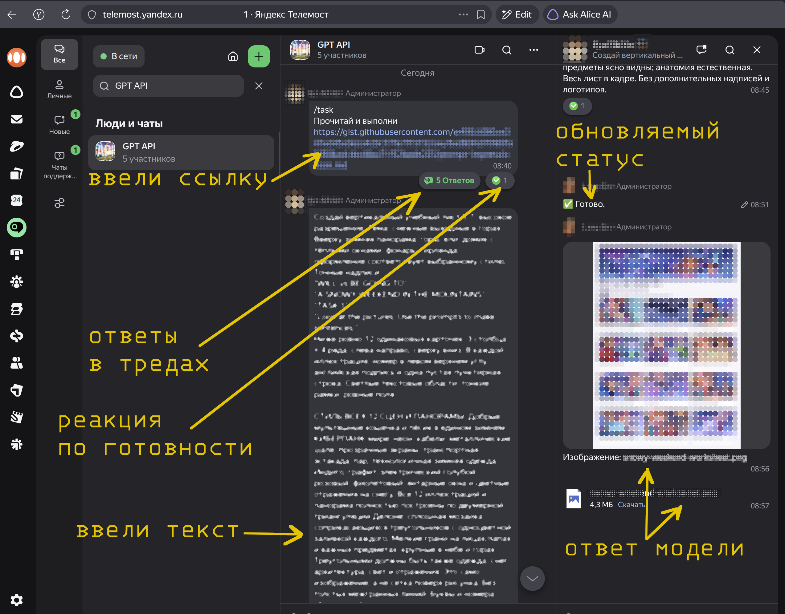

# Messenger Worksheets

Сервис связывает два чата Яндекс Мессенджера с OpenAI и Codex CLI.
Отвечает от выбранного пользовательского аккаунта, выполняет задачи
с инструментами и отправляет файлы в тред исходного сообщения.

В API-чате обычный текст обрабатывает OpenAI Responses API. Задачи
обоих чатов и обычные ответы Local-чата выполняет общий Codex worker.



## Попробовать

В настроенном чате отправьте:

```text
/task Создай hello.txt с текстом «Привет!» и пришли файл.
```

Сервис создаст тред со статусом выполнения и прикрепит результат.
[Первое задание](docs/tutorials/first-task.md) проведёт через этот пример.

## Документация

- [Все разделы](docs/index.md) — выбор по задаче читателя.
- [Установка](docs/how-to/install.md) — подготовка Linux и запуск служб.
- [Эксплуатация](docs/how-to/operate.md) — обновление и диагностика.
- [Команды чата](docs/reference/commands.md) — синтаксис и поведение.
- [Устройство сервиса](docs/explanation/architecture.md) — маршруты,
  контекст тредов и доставка.
- [Разработка](docs/how-to/develop.md) — код и локальные проверки.

Установщики рассчитаны на Linux с systemd, Python 3.14 и оператора
`w495`. Для другой учётной записи потребуется адаптация. Задачи имеют
доступ к сети и общему состоянию системного пользователя worker;
[границы доступа](docs/explanation/auth-and-permissions.md) стоит
учесть до подключения участников.

## Лицензия

[AGPL-3.0-only](LICENSE). Область применения описана в
[LICENSE_SCOPE.md](LICENSE_SCOPE.md).
