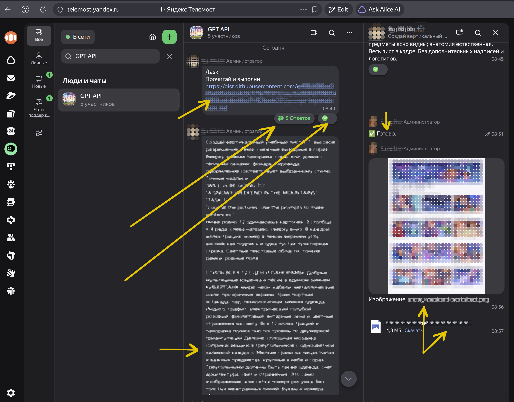

# Установка и эксплуатация

Команды ниже рассчитаны на два пользовательских чата: API и Local.
API-чат использует Responses API для обычного текста. Все задачи API-чата
и запросы Local-чата обслуживает Codex CLI в sandbox-worker.

## Подготовка VM

Нужны Python 3.14, systemd, OpenSSL, rsync, curl и установленный Codex CLI.

```bash
python3 --version
python3 -m ensurepip --version
/usr/local/bin/codex --version
systemctl --version
openssl version
```

Если Python сообщает, что `ensurepip` недоступен:

```bash
sudo apt install python3.14-venv
```

Установщики используют учётную запись `w495` и читают модель из
`/home/w495/.codex/config.toml`. Перед установкой проверьте в этом файле
`model` и `model_reasoning_effort`. Для другого Linux-пользователя
понадобится изменить скрипты и unit-файлы.

Зависимости закреплены в `messenger-worksheets/requirements.lock`.
Он рассчитан на Python 3.14 и Linux x86_64 с поддержкой manylinux_2_28.

## Первая установка

```bash
git clone https://github.com/w495/messenger-worksheets.git messenger-worksheets-install
cd messenger-worksheets-install
sudo bash deployment/install.sh
```

Установщик запросит OAuth пользовательского аккаунта Мессенджера и
OpenAI API key. Ввод скрыт. Сервисы на этом шаге не запускаются.

Создайте локальную конфигурацию:

```bash
cp deployment/instances.example.json deployment/instances.local.json
chmod 600 deployment/instances.local.json
```

Заполните её в редакторе:

- `expected_email` — email аккаунта, от имени которого сервис будет отвечать;
- `messenger_backend` — `cleanroom`;
- `instances.api.invite` — ссылка на API-чат;
- `instances.local_user.invite` — ссылка на Local-чат;
- `token_file` — абсолютный путь к OAuth-файлу с правами `0600`.
  Если используется OAuth из первого установщика, удалите поле `token_file`.

Аккаунт должен состоять в обоих чатах и иметь права отправлять сообщения,
вложения и реакции.

```bash
sudo bash deployment/install_admin_helper.sh
```

Этот скрипт проверяет аккаунт и ссылки на чаты, создаёт отдельные конфигурации,
обновляет код и устанавливает `worksheet-admin`.

`worksheet-admin` разрешает пользователю `w495` фиксированный набор
административных команд без пароля. Произвольные команды и пути он не принимает.
Доступ сохраняется, пока оператор явно его не отзовёт.

## Авторизация и запуск

Авторизуйте Codex под системным пользователем sandbox-worker:

```bash
sudo -n /usr/local/sbin/worksheet-admin login-sandbox-admin
```

Затем запустите обработчики и выполните проверки:

```bash
sudo -n /usr/local/sbin/worksheet-admin start-worker-api
sudo -n /usr/local/sbin/worksheet-admin start-worker-sandbox
sudo -n /usr/local/sbin/worksheet-admin check-messenger-api-cleanroom
sudo -n /usr/local/sbin/worksheet-admin check-messenger-local-cleanroom
sudo -n /usr/local/sbin/worksheet-admin smoke-api
sudo -n /usr/local/sbin/worksheet-admin smoke-sandbox-task
sudo -n /usr/local/sbin/worksheet-admin smoke-sandbox-link
```

Последние три команды проверяют текстовый API-ответ, создание `hello.txt`
и скачивание example.com. Проверка ссылки сравнивает возвращённый файл
с независимо полученным HTTP-ответом.

После успешных проверок запустите шлюзы:

```bash
sudo -n /usr/local/sbin/worksheet-admin start-gateway-api
sudo -n /usr/local/sbin/worksheet-admin start-gateway-sandbox
sudo -n /usr/local/sbin/worksheet-admin status
```

Отправьте в каждый чат:

```text
/task Создай файл check.txt с текстом OK и пришли его в чат.
```

Должны появиться файл, статус `✅ Готово.` и реакция ✅.
Для проверки изображений попросите создать PNG: он должен прийти картинкой
и отдельным документом.

Автозапуск включается для этих четырёх служб:

```bash
sudo systemctl enable worksheet-worker.service worksheet-worker-sandbox-admin.service \
  worksheet-gateway-api.service worksheet-gateway-sandbox-admin.service
```

## Службы и каталоги

| Служба | Назначение | Порт |
|---|---|---|
| `worksheet-worker.service` | Responses API для текста API-чата | 8443 |
| `worksheet-worker-sandbox-admin.service` | Codex CLI для задач обоих чатов и текста Local-чата | 8445 |
| `worksheet-gateway-api.service` | Приём и отправка сообщений API-чата | — |
| `worksheet-gateway-sandbox-admin.service` | Приём и отправка сообщений Local-чата | — |

`worksheet-worker-local-user.service` на порту 8444 — отдельный резервный
режим запуска Codex с правами `w495`. Это не активный обработчик Local-чата.
Общий старый шлюз и Team Bot API в этой схеме выключены.

В экспериментальном Team Bot API имя бота задаётся явно: через
`--expected-name` в `configure_bot.py` и `WORKSHEET_BOT_EXPECTED_NAME` в окружении
шлюза. Новый токен по умолчанию сохраняется в
`~/.config/messenger-worksheets/bot-token`. Ранее настроенные пути продолжают
работать, если указаны в конфигурации.

| Каталог | Содержимое |
|---|---|
| `/opt/messenger-worksheets/app` | Установленный код |
| `/opt/messenger-worksheets/venv` | Python-зависимости |
| `/etc/messenger-worksheets` | Конфигурации и TLS-ключи |
| `/var/lib/messenger-worksheets-worker` | Состояние API-worker |
| `/var/lib/messenger-worksheets-chat-admin` | Codex-авторизация и задачи sandbox-worker |
| `/var/lib/messenger-worksheets-gateway-api` | Состояние API-шлюза |
| `/var/lib/messenger-worksheets-gateway-sandbox-admin` | Состояние Local-шлюза |

OAuth Мессенджера доступен шлюзам, OpenAI API key — API-worker.
У каждого worker-профиля отдельные TLS-ключи, доверенный CA и RPC-токен.

## Работа в чатах

`/task`, HTTP(S)-ссылка или распознанное поручение направляет сообщение
в режим задач. Ссылку загружает worker своими инструментами. Содержимое страницы
не может менять его правила или давать дополнительные права.

Результаты отправляются в тред исходного сообщения. Индикатор выполнения
редактируется в одном сообщении. Реакции: 👀 — обработка, ✅ — успех,
💔 — ошибка задачи или доставки.

Нативный PNG может быть перекодирован Мессенджером. Копия PNG, отправленная
документом, сохраняет исходные байты. Поэтому изображения отправляются
двумя сообщениями.



Слева — исходное задание и ссылка на тред. Справа — статус `✅ Готово.`,
просмотр изображения и отдельное вложение для скачивания.

Входящие документы пока не передаются worker. Для текстового задания
используйте текст сообщения или публичную ссылку. Входящие изображения
поддерживаются.

Задача ограничена 30 минутами, ответ с файлами — 50 МиБ. Worker выполняет
до четырёх запросов одновременно; шлюз каждого чата обрабатывает сообщения
последовательно. Все задачи sandbox-worker используют один системный аккаунт,
его состояние и модельную квоту.

Sandbox-worker работает с сетью и `danger-full-access` внутри ограничений
systemd. Он не получает доступ к домашним каталогам, но может читать собственную
Codex-авторизацию и данные других задач этого аккаунта.

## Обновление

Дождитесь завершения текущих задач. Остановите шлюзы, обновите исходники
и установите их:

```bash
sudo -n /usr/local/sbin/worksheet-admin stop-gateway-api
sudo -n /usr/local/sbin/worksheet-admin stop-gateway-sandbox
git pull --ff-only
sudo bash deployment/install_admin_helper.sh
sudo -n /usr/local/sbin/worksheet-admin restart-worker-api
sudo -n /usr/local/sbin/worksheet-admin restart-worker-sandbox
sudo -n /usr/local/sbin/worksheet-admin start-gateway-api
sudo -n /usr/local/sbin/worksheet-admin start-gateway-sandbox
sudo -n /usr/local/sbin/worksheet-admin status
```

Повторно запускать `install.sh` для обновления не нужно: он заново запрашивает
и записывает секреты. Для обновления кода предназначен `install_admin_helper.sh`.

Не удаляйте SQLite-файлы состояния при обычном обновлении или откате:
это может вызвать повторную обработку сообщений.

## Диагностика

```bash
sudo -n /usr/local/sbin/worksheet-admin logs-gateway-api
sudo -n /usr/local/sbin/worksheet-admin logs-gateway-sandbox
sudo -n /usr/local/sbin/worksheet-admin logs-worker-api
sudo -n /usr/local/sbin/worksheet-admin logs-worker-sandbox
```

При HTTP 503 проверьте журнал соответствующего worker.
`diagnose-openai` проверяет OpenAI API и доступность Codex CLI, выводя
категории ошибок без ключей и сырых ответов:

```bash
sudo -n /usr/local/sbin/worksheet-admin diagnose-openai
```

Если TLS-проверка не проходит:

```bash
sudo bash deployment/repair_tls.sh
sudo -n /usr/local/sbin/worksheet-admin check-tls-isolation
```

Не публикуйте содержимое файлов окружения, OAuth-файлов и приватных TLS-ключей.

## Остановка и отзыв административного доступа

```bash
sudo -n /usr/local/sbin/worksheet-admin stop-gateway-api
sudo -n /usr/local/sbin/worksheet-admin stop-gateway-sandbox
sudo -n /usr/local/sbin/worksheet-admin stop-worker-api
sudo -n /usr/local/sbin/worksheet-admin stop-worker-sandbox
```

Состояние и секреты при остановке сохраняются.

Если оператор решил удалить административный helper:

```bash
sudo -n /usr/local/sbin/worksheet-admin revoke
```

Команда удалит sudoers-правило и helper. Для восстановления потребуется
снова выполнить `sudo bash deployment/install_admin_helper.sh`.

## Совместимость со старым клиентом

Основной клиент выбирается настройкой `messenger_backend=cleanroom`.
Переключение уже установленного шлюза:

```bash
sudo -n /usr/local/sbin/worksheet-admin activate-cleanroom-api
sudo -n /usr/local/sbin/worksheet-admin activate-cleanroom-sandbox
```

Режим `legacy` требует отдельно установленного старого клиента.
Команды `rollback-legacy-api` и `rollback-legacy-sandbox` сначала проверяют
его наличие и аккаунт. Если проверка не проходит, работающий шлюз не меняется.
