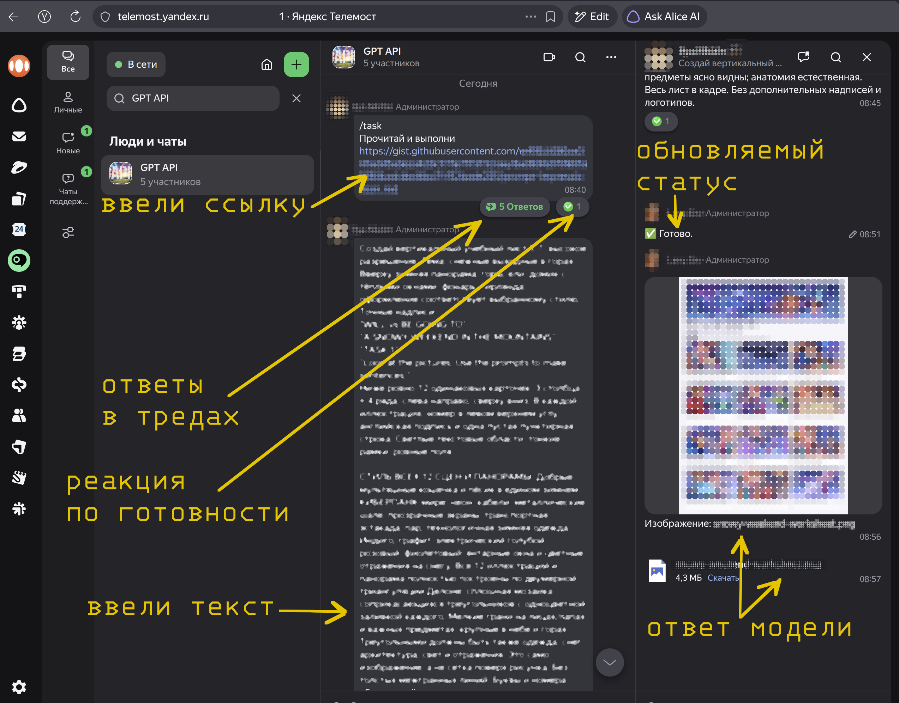

# Первое задание и файл в треде

За это упражнение вы отправите задание, скачаете файл и попросите
изменить его. Нужен доступ к уже настроенному API- или Local-чату.
Если сервис ещё не установлен, начните с
[руководства установки](../how-to/install.md).

## 1. Создайте файл

Откройте чат и отправьте отдельным сообщением:

```text
/task Создай hello.txt с одной строкой «Привет!» и пришли файл.
```

На исходном сообщении появится реакция 👀. Сервис создаст тред и будет
обновлять в нём сообщение с индикатором выполнения. Откройте этот тред.

При успешном выполнении индикатор станет `✅ Готово.`, реакция исходного
сообщения — ✅. В треде появится документ `hello.txt`. Скачайте его
и откройте: внутри должна быть строка «Привет!».

## 2. Продолжите в том же треде

Ответьте в созданном треде:

```text
Добавь во вторую строку «Файл готов» и пришли обновлённый hello.txt.
```

Повторять `/task` не требуется: продолжение файловой задачи сохраняет
режим работы с инструментами. Сервис использует копию предыдущего файла.
Скачайте новый документ и проверьте обе строки.

## 3. Посмотрите настройки

В том же треде отправьте:

```text
/model
```

Ответ покажет модель и уровень размышлений для обычных ответов и задач.
Команда не запускает модель. Настройки и история относятся к этому
треду; отдельное сообщение в основном чате начинает новый контекст.



На скриншоте показана похожая задача с PNG. Изображение приходит
картинкой для просмотра и документом для скачивания исходного файла.

Если вместо результата появился статус `❌ Ошибка.` и реакция 💔,
передайте оператору текст ошибки и ссылку на тред. Команда `/status`
показывает состояние текущего запроса, `/stop` останавливает его.

Теперь можно отправлять свои задания. Точный синтаксис и ограничения
приведены в [справочнике команд](../reference/commands.md) и
[справочнике конфигурации](../reference/configuration.md).
